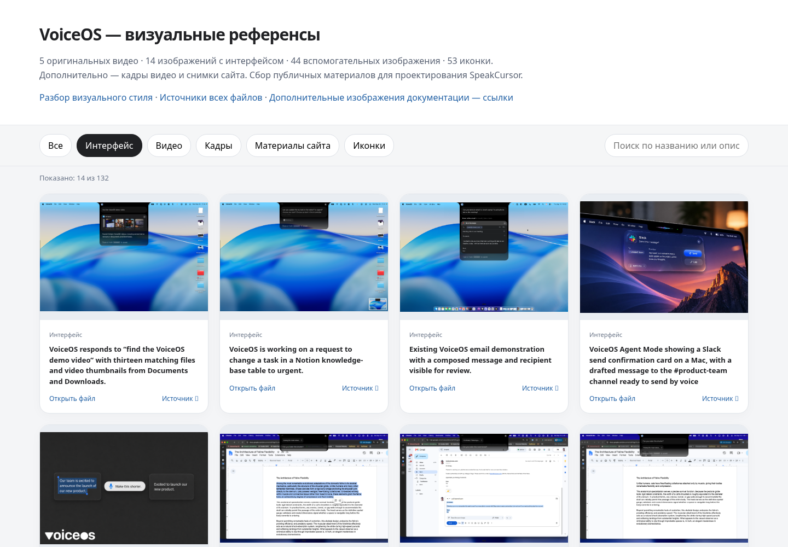
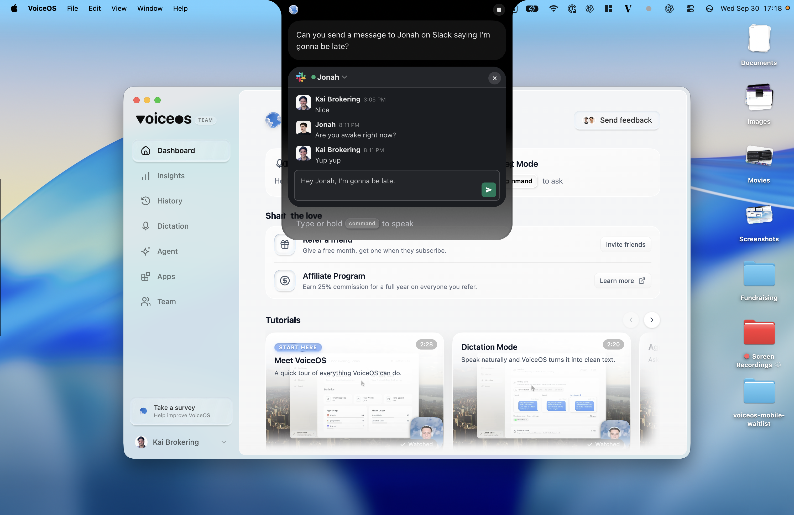
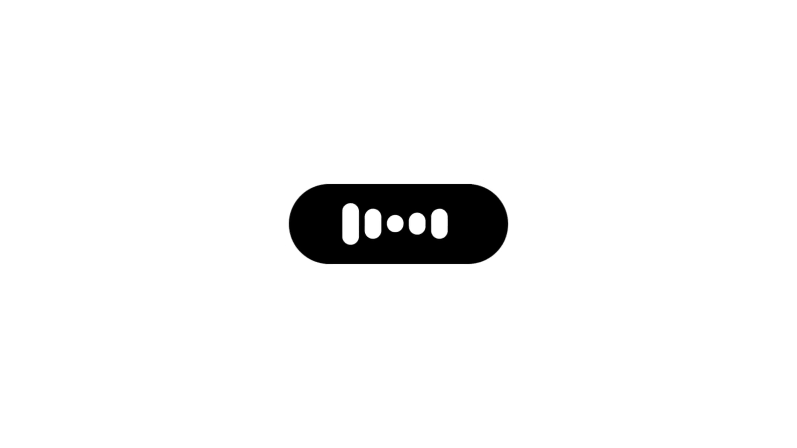

# Исследование и визуальные референсы VoiceOS

Публичные материалы собраны 15 октября 2026 года и перенесены в репозиторий 16 октября, чтобы ими можно было пользоваться после смены аккаунта или машины.

Это исследование стороннего продукта. Состав собственной первой версии определяется [решениями пользователя](../../product-scope.md), а не каталогом возможностей VoiceOS.

## Что открыть

- [Полный разбор на русском](analysis.ru.md), включая все 175 инструментов каталога.
- [Покадровый разбор жеста «Point anywhere on your screen»](point-anywhere.ru.md).
- [Разбор визуального стиля](visual-reference/VISUAL_STYLE_RU.md).
- [Локальная галерея](visual-reference/gallery.html): фильтры, поиск, изображения и видеоплееры. После клонирования её можно открыть в браузере; GitHub отображает HTML как исходный файл.
- [Данные 21 интеграции](integrations.json).
- [Оригинальные источники медиа](visual-reference/download-manifest.json).
- [Ссылки на дополнительные изображения документации](visual-reference/documentation-image-links.json).
- [Контрольные суммы 116 оригинальных медиафайлов](SHA256SUMS).

## Комплект материалов

| Материалы | Количество | Расположение |
| --- | ---: | --- |
| Демонстрационные видео | 5 | [videos](visual-reference/videos/) |
| Изображения с интерфейсом | 14 | [screenshots](visual-reference/screenshots/) |
| Фоны, постеры и дополнительные изображения | 44 | [images](visual-reference/images/) |
| Иконки | 53 | [icons](visual-reference/icons/) |
| Извлечённые кадры и монтажные листы | 9 | [video-frames](visual-reference/video-frames/) |
| Снимки публичных источников | 69 исходных ответов, а также извлечённый текст и ссылки | [sources](sources/) |

Видео сохранены полностью, а не только ссылками. Все 116 загруженных оригинальных медиа сохранены без изменения содержимого. Их можно проверить из этой директории командой `sha256sum -c SHA256SUMS`.

Пять роликов: запуск продукта и диктовка, презентация агента, обводка экрана, поиск файлов, напоминание. Размер каждого файла меньше 14 МБ; Git LFS для этого набора не нужен. Старый ZIP с теми же файлами не дублируется: сами материалы уже находятся в Git.

## Быстрый визуальный просмотр

Предпросмотр галереи:

Основное окно и раскрытая верхняя панель в публичном снимке VoiceOS:

Панель диктовки в демонстрационном ролике:

## Источники и ограничения

- Официальные страницы продукта, статьи, changelog и документация, а также страница компании на Y Combinator.
- В `sources/` находятся исходные ответы, читаемый текст, карты ссылок и метаданные. Они сохраняют состояние исследования, а не обещают актуальность сайта после этой даты.
- В архивных страницах удалены значения временных параметров подписанных URL; это не меняет собранный текст исследования. Оригинальные загруженные медиа проверяются отдельно по контрольным суммам.
- Внутри набора различаются реальные снимки интерфейса, рекламные анимации, изображения-обложки и статическое воспроизведение веб-компонентов.
- Преимущественно показана macOS; снимки относятся к разным версиям продукта.
- Пробная загрузка с отдельного CDN документации вернула HTTP 403. 14 ссылок на такие изображения сохранены, но сами изображения не были загружены. Внешние видео о других продуктах тоже оставлены ссылками.
- Установленное приложение VoiceOS не тестировалось. Точность распознавания, задержка и рекламная оценка продуктивности не проверялись.

## Воспроизведение исследования

В `tools/` сохранены вспомогательные скрипты сбора и галереи. Они используют пути относительно собственного расположения, а не старой облачной машины:

- `crawl.py` — сохранить публичные страницы и извлечённый текст в `sources/`.
- `collect_media.py` — собрать доступные медиа из сохранённых страниц.
- `capture_website_verified.py` — воспроизвести сохранённые страницы в Chromium, загружая сетевые ресурсы с проверкой TLS средствами Python.
- `build_gallery.py` — пересобрать галерею из сохранённого манифеста.

Для изучения готовых материалов запуск скриптов не требуется. Для пересборки галереи нужны Python и `ffprobe`; браузерные снимки дополнительно требуют Playwright и Chromium. Новый сбор может изменить набор и зависит от текущего сайта и сети.
